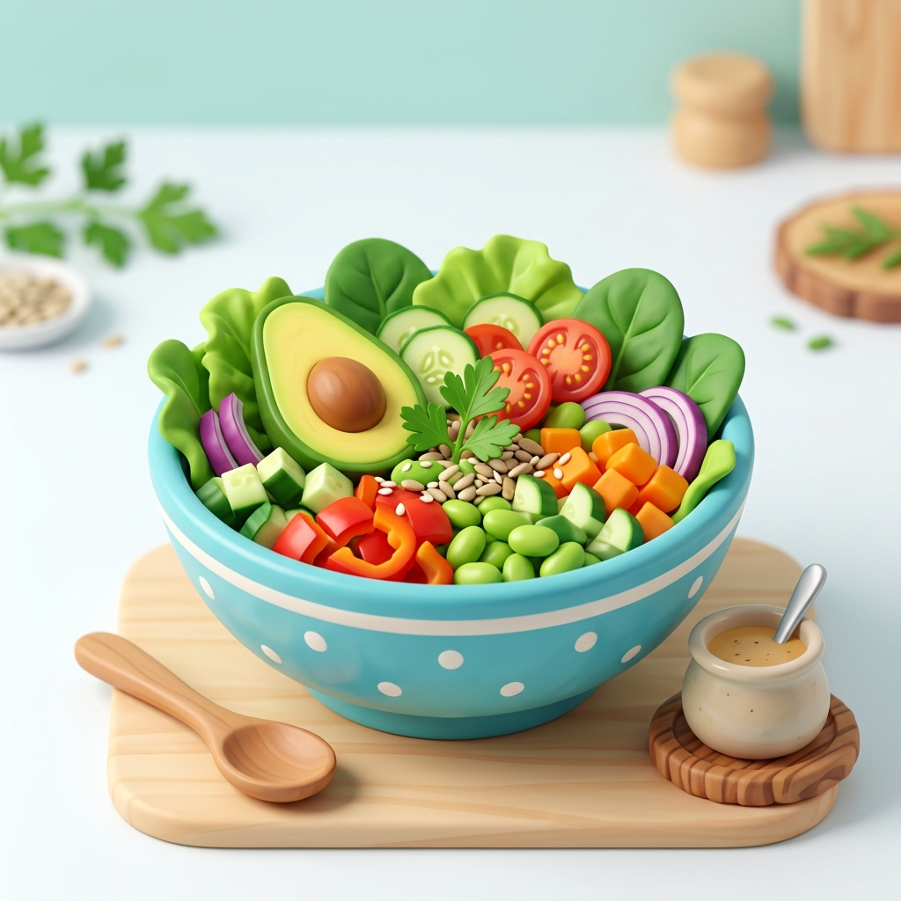

# NutriApp - Plataforma Integral de Nutrición Digital



**NutriApp** es una plataforma web integral que conecta a **pacientes (clientes)** con **nutricionistas profesionales certificados**, facilitando el diseño de planes alimentarios personalizados, el seguimiento continuo de progreso físico y la comunicación fluida entre ambas partes.

La aplicación cuenta con una **estética de ilustración 3D estilizada (estilo Pixar / videojuegos tipo Overcooked)** con un enfoque profesional y sobrio, y está impulsada por un backend en Node.js/Express integrado con el motor relacional de **SpiderWeb API SQL Engine** (`sw_GaboDev24_NUTRIAPP_db`).

---

## 📑 Tabla de Contenidos

1. [Características Principales](#-características-principales)
2. [Funcionalidades para Clientes / Pacientes](#-funcionalidades-para-clientes--pacientes)
3. [Funcionalidades para Nutricionistas Profesionales](#-funcionalidades-para-nutricionistas-profesionales)
4. [Diseño & Estética Visual](#-diseño--estética-visual)
5. [Arquitectura del Proyecto & SDK Client](#-arquitectura-del-proyecto--sdk-client)
6. [Instalación y Configuración](#-instalación-y-configuración)
7. [Licencia](#-licencia)

---

## 🌟 Características Principales

- **Ecosistema Multiusuario**: Registro diferenciado para Pacientes (clientes) y Nutricionistas profesionales.
- **Generación de Rutinas Personalizadas**: Creación automática y manual de dietas según peso, altura y estilo de vida.
- **Control y Monitoreo de Progreso**: Historial estadístico de evolución de peso y hábitos saludables.
- **Mensajería Interna**: Chat directo y privado en tiempo real entre el paciente y su profesional asignado.
- **Motor SQL SpiderWeb API**: Persistencia de datos mediante cliente/SDK centralizado (`/api-client`) consumiendo SQL Database, Storage y SpiderIA.
- **Diseño Mobile-First & Accesible**: Menú hamburguesa slide-in animado, tarjetas 3D renders con sombras profundas y tipografía fluida `clamp()`.

---

## 👤 Funcionalidades para Clientes / Pacientes

La experiencia del paciente está orientada a brindarle acompañamiento constante y facilitarle el cumplimiento de sus metas de salud:

### 1. Registro y Autenticación Segura
- Creación de cuenta con rol **Paciente**.
- Sistema de verificación de correo electrónico con token seguro y activación automática de respaldo.
- Recuperación y restablecimiento de contraseña mediante token expirable.

### 2. Onboarding Nutricional
- Formulario interactivo inicial para ingresar **altura (cm)**, **peso actual (kg)** y **estilo de vida** (sedentario, activo, deportista).
- Generación automática de una rutina alimentaria inicial desglosada en comidas diarias (Desayuno, Almuerzo, Merienda, Cena) con metas calóricas y pautas de hidratación.

### 3. Panel de Control del Paciente (`user-dashboard.html`)
- Visualización interactiva del plan alimentario asignado por su nutricionista o generado automáticamente.
- Resumen de comidas recomendadas, porciones y calorías diarias.
- Recomendaciones generales de salud y hábitos saludables.

### 4. Registro Diario de Progreso (`patient-stats.html`)
- Carga periódica del peso corporal y notas/sensaciones diarias.
- Tabla e historial de los últimos 30 registros de progreso.
- Indicadores visuales de cambio de peso total (diferencia respecto al peso inicial).

### 5. Catálogo de Nutricionistas & Solicitud de Atención
- Listado público y privado de profesionales registrados en la plataforma.
- Envío de solicitud de atención directa al nutricionista elegido para iniciar un tratamiento personalizado.

### 6. Chat y Mensajería con el Nutricionista
- Sección de mensajes directos para consultar dudas sobre ingredientes, sustituciones o porciones directamente con su profesional asignado.

---

## 🩺 Funcionalidades para Nutricionistas Profesionales

Para los profesionales de la salud, NutriApp actúa como un software de gestión clínica de pacientes:

### 1. Registro Profesional
- Perfil profesional con especialización, número de matrícula, biografía, experiencia y credenciales.
- Aparición dinámica en el catálogo público de profesionales de la plataforma.

### 2. Panel Profesional (`pro-dashboard.html`)
- Vista general de la cartera de pacientes asignados.
- Centro de solicitudes de atención pendientes con opciones para **Aceptar** o **Denegar** nuevos pacientes.

### 3. Ficha y Estadísticas del Paciente (`patient-profile.html`)
- Acceso al historial estadístico completo de cada paciente.
- Gráficos y métricas de evolución de peso y nivel de actividad.

### 4. Diseñador de Dietas y Rutinas
- Creación, edición y actualización en tiempo real del plan alimentario del paciente.
- Inclusión de recomendaciones específicas y personalización de comidas.

### 5. Comunicación Directa
- Bandeja de mensajes para responder dudas y realizar el seguimiento continuo de sus pacientes.

---

## 🎨 Diseño & Estética Visual

El sitio web sigue estrictamente los lineamientos de **`DESIGN.md`**:

- **Paleta de Colores**:
  - **Base**: Azul profundo (`#0f172a`, `#1e3a8a`), verde salvia (`#10b981`, `#059669`) y neutros limpios (`#f8fafc`).
  - **CTAs y Acentos**: Naranja/coral cálido (`#f97316`) para llamar la atención en botones principales.
- **Ilustraciones 3D Cartoon**: Renderizados con estilo tipo Overcooked / Pixar (plato de alimentos frescos, avatars y elementos ilustrados).
- **Tipografía**: Google Fonts **Outfit** (títulos bold con personalidad sobria) e **Inter** (cuerpo de texto legible).
- **Navegación Desktop & Mobile**: Header sticky con sombra al scroll y menú hamburguesa mobile slide-in con overlay semitransparente.

---

## 🏗️ Arquitectura del Proyecto & SDK Client

La estructura del código está organizada de forma modular:

```text
NutriApp-Page/
├── api-client/                 # SDK Cliente para SpiderWeb REST API
│   ├── client.js               # Cliente HTTP base (X-API-KEY, timeout, errores 4xx/5xx)
│   ├── sql.js                  # Submódulo SQL Database (listDatabases, listTables, query)
│   ├── storage.js              # Submódulo Storage (proyectos y archivos multipart/binarios)
│   ├── ia.js                   # Submódulo SpiderIA (listModels, chat, getUsage)
│   ├── index.js                # Exportador principal del SDK
│   └── example.js              # Script de prueba completo del SDK
├── public/                     # Frontend HTML/CSS/JS (Landing page y Paneles)
│   ├── assets/                 # Ilustraciones 3D y recursos gráficos
│   ├── css/
│   │   └── style.css           # Sistema de diseño CSS3
│   ├── js/
│   │   ├── auth.js             # Lógica de Login/Signup
│   │   ├── dashboard.js        # Lógica del panel de paciente
│   │   ├── pro-dashboard.js    # Lógica del panel profesional
│   │   └── patient-profile.js  # Lógica de ficha de paciente
│   ├── index.html              # Landing Page oficial de NutriApp
│   ├── login.html              # Inicio de Sesión
│   ├── signup.html             # Registro (Paciente / Nutricionista)
│   ├── user-dashboard.html     # Dashboard Paciente
│   └── pro-dashboard.html      # Dashboard Profesional
├── server/                     # Servidor Express.js
│   ├── index.js                # Punto de entrada del servidor
│   ├── dbInit.js               # Auto-inicializador de tablas SQL
│   ├── dbHelper.js             # Helper para consultas SQL preparadas
│   ├── middleware/
│   │   └── auth.js             # Middleware de autenticación JWT
│   └── routes/
│       ├── auth.js             # Rutas de autenticación
│       ├── user.js             # Rutas de paciente
│       ├── professional.js     # Rutas de nutricionista
│       └── public.js           # Rutas públicas (catálogo de nutricionistas)
├── .env                        # Variables de entorno
├── DESIGN.md                   # Guía de diseño estético
├── package.json                # Configuración y dependencias Node.js
└── README.md                   # Documentación del proyecto
```

---

## 🛠️ Instalación y Configuración

### Prerrequisitos
- **Node.js**: v18.0.0 o superior.
- **npm**: v9.0.0 o superior.

### 1. Clonar el repositorio
```bash
git clone https://github.com/GaboDev24/NutriApp-Page.git
cd NutriApp-Page
```

### 2. Instalar dependencias
```bash
npm install
```

### 3. Configurar variables de entorno (`.env`)
Crea o edita el archivo `.env` en la raíz del proyecto con la siguiente configuración:

```env
SPIDERWEB_API_KEY=b243dd0fadcd6b70794333e65f1ca0b1f2fbc92d5518901f9a529300e869a93c
SPIDERWEB_API_BASE_URL=https://spiderwebargapi.com.ar/api/v1
DB_NAME=sw_GaboDev24_NUTRIAPP_db
CLOUD_ID=28
JWT_SECRET=TuSecretJWT
EMAIL_USER=tuemail@gmail.com
EMAIL_PASS=tu_password_de_aplicacion
BASE_URL=http://localhost:3000
NODE_ENV=development
PORT=3000
```

### 4. Ejecutar la aplicación en desarrollo
```bash
npm start
```

Abre tu navegador en `http://localhost:3000` para acceder a NutriApp.

### 5. Probar el SDK Cliente SpiderWeb API
Para verificar la conexión con los submódulos de **SQL Database**, **Storage** y **SpiderIA**:
```bash
node api-client/example.js
```

---

## 📄 Licencia

Este proyecto está desarrollado bajo la licencia **ISC**. Todos los derechos reservados NutriApp 2026.
